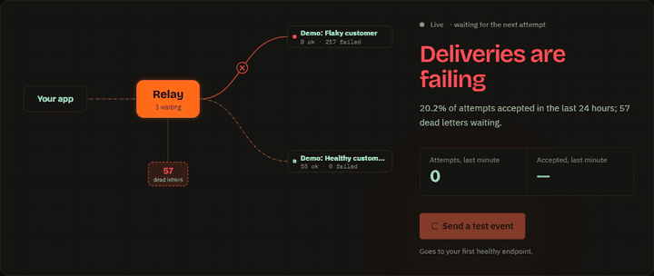
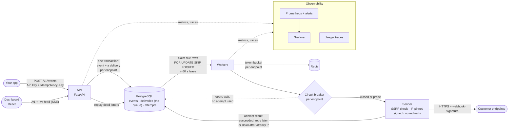
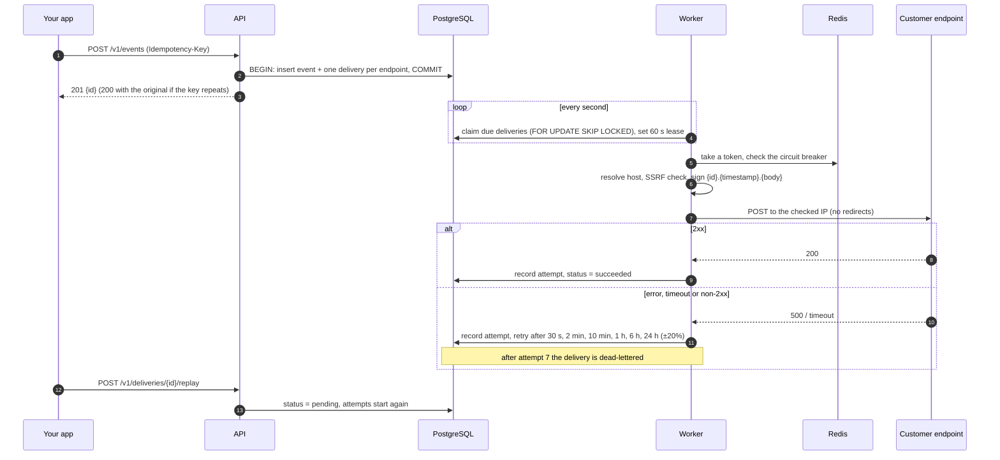
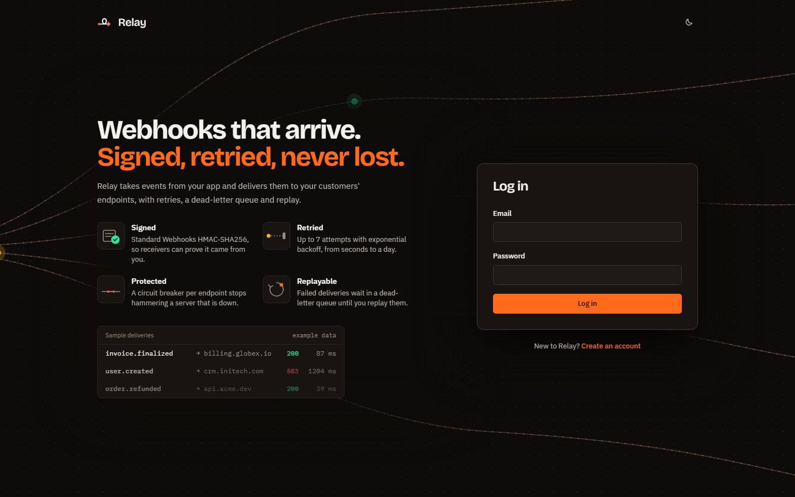
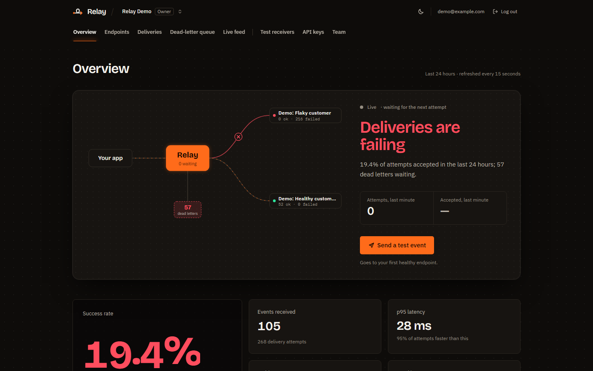
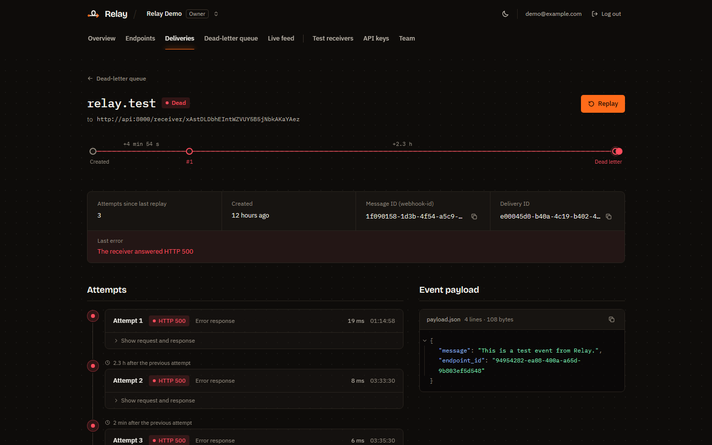
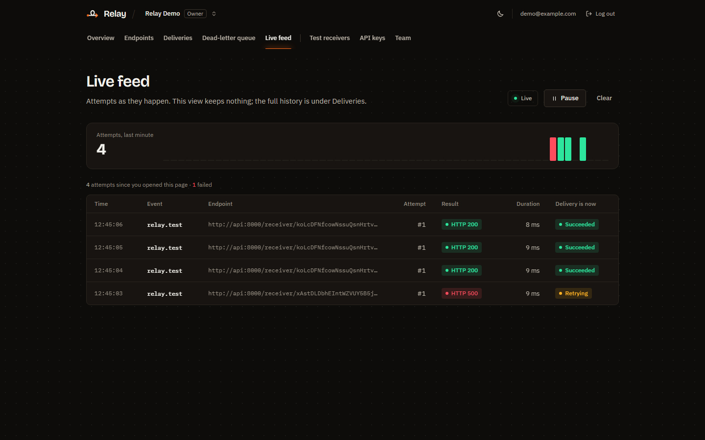

#  Relay

Reliable, signed webhook delivery: a transactional outbox, retries with backoff, a dead-letter queue and replay.

[](https://github.com/priyadharshanexe/relay/actions/workflows/ci.yml)
[](LICENSE)


Your app sends Relay an event with one HTTP call. Relay stores it, signs it and delivers it to every endpoint your customers have registered. If an endpoint is down, Relay retries on a schedule, stops hammering it with a circuit breaker, and keeps what still fails in a dead-letter queue until you replay it.

**Live demo:** [relay-3y3s.onrender.com](https://relay-3y3s.onrender.com) (public demo account, details on the sign-in page)

## Watch the demo

https://github.com/user-attachments/assets/210d8f91-fea9-472b-aa06-d9f3f394cdb4

## The delivery map



<sub>Every delivery travels as a packet from your app, through Relay, to each endpoint.</sub>

## Contents

- [Watch the demo](#watch-the-demo)
- [Features](#features)
- [Architecture](#architecture)
- [The life of one delivery](#the-life-of-one-delivery)
- [Guarantees](#guarantees)
- [Quick start](#quick-start)
- [Sending events and verifying signatures](#sending-events-and-verifying-signatures)
- [Development](#development)
- [Tests and CI](#tests-and-ci)
- [Observability](#observability)
- [Load test](#load-test)
- [Security](#security)
- [Project layout](#project-layout)
- [Licence](#licence)

## Features

- **Transactional outbox.** An event and its deliveries are written in one database transaction, so an accepted event is never lost between "saved" and "queued".
- **Postgres as the queue.** Workers claim deliveries with `FOR UPDATE SKIP LOCKED` and a lease, so any number of workers can run side by side and a crashed worker's work is picked up again.
- **Retries with jitter.** Seven attempts over about 31 hours, each delay moved by up to ±20%. A receiver's `Retry-After` header is respected, up to one hour.
- **Circuit breaker per endpoint.** After 5 failures in a row the endpoint is paused for 60 seconds, then one probe decides whether it opens or closes. Deliveries wait while it is open; they do not use up attempts.
- **Rate limit per endpoint.** An optional token bucket in Redis, shared by all workers, so a receiver that comes back after an outage is not flooded.
- **Event types.** Each endpoint subscribes to the event types it wants; an empty list means all of them.
- **Dead-letter queue and replay.** Replay one delivery or every dead delivery matching a filter.
- **Standard Webhooks signatures.** HMAC-SHA256 over id, timestamp and body, with secret rotation that keeps the old secret valid for 24 hours.
- **SSRF protection.** Every resolved address is checked, the connection is pinned to the checked IP, and redirects are never followed.
- **Idempotent ingestion.** Send the same `Idempotency-Key` twice and you get the original event back, not a duplicate.
- **Teams.** Organisations with owner, developer and viewer roles, invitations by link, and an audit log.
- **Built-in test receivers.** Endpoints you can point at that always succeed, fail, rate-limit, respond slowly or never respond.
- **Dashboard.** A live delivery map, delivery history with a retry timeline, a dead-letter queue, a live feed over server-sent events, light and dark themes.
- **Observability.** Prometheus metrics, alert rules with runbooks and unit tests, a Grafana dashboard, and OpenTelemetry traces that follow one webhook from the API call to the outbound request.

## Architecture



**API** ([relay/api](relay/api)). FastAPI. It authenticates the request (an API key for sending events, a session cookie for the dashboard), checks the body and writes rows. It never calls a customer's server, so a slow receiver cannot slow it down.

**Outbox and queue** ([relay/services/events.py](relay/services/events.py), [relay/worker/claim.py](relay/worker/claim.py)). Ingestion inserts the event and one `deliveries` row per subscribed endpoint in one transaction. That table is the queue: there is no separate broker to keep in step with the database.

**Workers** ([relay/worker](relay/worker)). Each worker claims a batch of due deliveries with `UPDATE … FOR UPDATE SKIP LOCKED` and sets `locked_until` (a 60-second lease). The claim commits before any HTTP call is made, so no transaction stays open while a receiver is slow. If a worker dies, a sweep returns its expired leases to the queue. One worker sends up to 20 deliveries at once.

**Rate limit and circuit breaker** ([relay/domain/rate_limit.py](relay/domain/rate_limit.py), [relay/domain/circuit_breaker.py](relay/domain/circuit_breaker.py)). Before sending, the worker takes a token from the endpoint's bucket in Redis (one Lua script, so all workers share it) and asks the breaker whether the endpoint is open. Either one can postpone a delivery without costing it an attempt. Both are pure functions with the I/O kept outside, so every transition is unit-tested.

**Sender** ([relay/worker/sender.py](relay/worker/sender.py), [relay/domain/ssrf.py](relay/domain/ssrf.py)). Resolves the endpoint's hostname, refuses private, loopback, link-local and reserved addresses, connects to the checked IP while keeping the original Host header and TLS name, signs the request and sends it with a 5-second connect and 15-second total timeout.

**Retries and dead letters** ([relay/domain/backoff.py](relay/domain/backoff.py), [relay/services/deliveries.py](relay/services/deliveries.py)). A failed attempt is recorded and the delivery is rescheduled; after the last attempt it is marked `dead`. Replay puts dead (or succeeded) deliveries back in the queue with a fresh attempt count.

**Dashboard** ([frontend](frontend)). React 19, TypeScript, TanStack Query and Tailwind. It uses the same `/v1` API as everyone else.

**Observability** ([infra/observability](infra/observability)). Prometheus scrapes the API and every worker; Grafana shows the "Relay overview" dashboard; Jaeger shows traces.

## The life of one delivery



## Guarantees

| Guarantee | What it means | Where it is enforced |
|---|---|---|
| **At-least-once delivery** | An accepted event is delivered to each subscribed endpoint at least once. A receiver can see the same message twice (for example, if a worker crashes after sending but before recording the result), so receivers should drop duplicates by `webhook-id`. | [claim.py](relay/worker/claim.py) (leases and sweep); load test: 8,286 in, 8,286 delivered once |
| **No ordering guarantee** | Deliveries for different events can arrive in any order, and a retry can arrive after a later event. Use the event's timestamp or your own sequence numbers if order matters. | by design: workers send in parallel and retry independently |
| **Idempotent ingestion** | The same `Idempotency-Key` returns the original event (200) instead of creating another; the same key with a different body is refused (409). | [api/events.py](relay/api/events.py) |
| **One active claim per delivery** | Two workers never send the same delivery at the same time. | `FOR UPDATE SKIP LOCKED` plus a status check in the claim, [claim.py](relay/worker/claim.py) |
| **Retry schedule** | 7 attempts: immediately, then 30 s, 2 min, 10 min, 1 h, 6 h and 24 h later, each ±20%. A `Retry-After` header is honoured up to 1 hour. Then the delivery is dead-lettered. Configurable with `RELAY_RETRY_SCHEDULE_SECONDS`. | [backoff.py](relay/domain/backoff.py) |
| **Signed requests** | Every request carries `webhook-id`, `webhook-timestamp` and `webhook-signature: v1,<base64 HMAC-SHA256>` over `{id}.{timestamp}.{body}` ([Standard Webhooks](https://www.standardwebhooks.com)). | [signing.py](relay/domain/signing.py) |
| **Secret rotation overlap** | After a rotation, requests are signed with both the new and the old secret for 24 hours (`RELAY_SECRET_ROTATION_OVERLAP_HOURS`), so receivers can switch without dropping any. | [services/endpoints.py](relay/services/endpoints.py) |

## Quick start

Requirements: Docker Desktop.

```bash
docker compose up --build
```

| Service  | Address |
|----------|---------|
| Dashboard | http://localhost:8080 |
| API      | http://localhost:8000 (interactive docs at http://localhost:8000/docs) |
| Postgres | `localhost:5433`, user/password/database `relay` |
| Redis    | `localhost:6379` |
| Grafana  | http://localhost:3000 (the "Relay overview" dashboard, no login locally) |
| Prometheus | http://localhost:9090 (alerts under Alerts) |
| Jaeger   | http://localhost:16686 (traces) |

Postgres is published on host port 5433, not 5432, so it never clashes with a Postgres you may already have installed. If a port is already taken on your machine, pick another with `RELAY_API_HOST_PORT`, `RELAY_POSTGRES_HOST_PORT` or `RELAY_REDIS_HOST_PORT` (in `.env` or the environment), for example `RELAY_API_HOST_PORT=8001 docker compose up`. The API port is published on this machine only (`127.0.0.1`); visitors reach the API through the dashboard's address.

### Demo data

```bash
docker compose exec api python -m relay.seed
```

This creates an organisation called "Relay Demo" with an owner account, an API key, two test receivers (one that accepts webhooks, one that fails) with an endpoint pointing at each, and five sample events. Log in at http://localhost:8080 as `demo@example.com` with the password in `RELAY_DEMO_PASSWORD` (`relay-demo-account` unless you change it). Running it again changes nothing; if something was deleted, it is put back. It never prints a secret.

### Housekeeping

The worker also runs two background jobs:

- **Retention:** events older than `RELAY_RETENTION_DAYS` (30) are deleted with their deliveries and attempts, in small batches. An event with a delivery still pending, in flight or retrying is never deleted.
- **Demo reset** (only when `RELAY_DEMO_MODE=true`, for a public demo): once a day at `RELAY_DEMO_RESET_HOUR_UTC` (03:00 UTC), all data is deleted and the demo is seeded again. It runs once a day however many workers there are.

Sign-up is limited per client address (`RELAY_REGISTRATIONS_PER_HOUR`, 10 by default); over the limit, the API answers 429 with a `Retry-After` header.

Check it's up:

```bash
curl http://localhost:8000/readyz
# {"status":"ok","checks":{"database":"ok","redis":"ok"}}
```

## Sending events and verifying signatures

Create an API key on the dashboard's **API keys** page, then:

```bash
curl -X POST http://localhost:8000/v1/events \
  -H "Authorization: Bearer $RELAY_API_KEY" \
  -H "Content-Type: application/json" \
  -H "Idempotency-Key: order-42-paid" \
  -d '{"type": "order.paid", "payload": {"order_id": 42, "amount": 1999}}'
```

### API

All routes are under `/v1`; the full schema is at `/docs`. Sending events uses an API key (`Authorization: Bearer <key>`). Everything else is for people: a session cookie from `/v1/auth/login` (or the same token as a Bearer header), with the organisation chosen by `X-Org-ID`. Viewers can read; owners and developers can make changes; managing the organisation and its members is for owners.

| Area | Routes | Auth |
|---|---|---|
| Events | `POST /events`, `GET /events`, `GET /events/{id}` | API key to send; session to read |
| Endpoints | `GET/POST /endpoints`, `GET/PATCH/DELETE /endpoints/{id}`, `POST /endpoints/{id}/pause`, `/resume`, `/rotate-secret`, `/test`, `GET /endpoints/health` | session |
| Deliveries | `GET /deliveries`, `GET /deliveries/{id}`, `POST /deliveries/{id}/replay`, `POST /deliveries/replay` (bulk, by filter) | session |
| Live feed | `GET /stream/deliveries` (server-sent events) | session |
| Stats | `GET /stats/overview` | session |
| API keys | `GET/POST /api-keys`, `DELETE /api-keys/{id}` | session (owner or developer) |
| Test receivers | `GET/POST /receivers`, `PATCH/DELETE /receivers/{id}` | session |
| Auth | `POST /auth/register`, `/login`, `/refresh`, `/logout`, `GET /auth/me` | none / session |
| Organisation and team | `GET /orgs`, `PATCH /orgs/current`, members and invitations under `/orgs/current/…`, `GET/POST /invitations/{token}` | session |
| Health | `GET /healthz`, `GET /readyz`, `GET /metrics` | none |

### Verifying a webhook

The secret is shown once when you create an endpoint (`whsec_…`). Check the timestamp, recompute the signature and compare it in constant time. During a rotation the header carries two signatures; accept either.

Python:

```python
import base64, hashlib, hmac, time


def verify(secret: str, headers: dict, body: bytes, tolerance: int = 300) -> bool:
    key = base64.b64decode(secret.removeprefix("whsec_"))
    msg_id, ts = headers["webhook-id"], headers["webhook-timestamp"]
    if abs(time.time() - int(ts)) > tolerance:
        return False
    expected = base64.b64encode(
        hmac.new(key, f"{msg_id}.{ts}.".encode() + body, hashlib.sha256).digest()
    ).decode()
    return any(
        hmac.compare_digest(sig.partition(",")[2], expected)
        for sig in headers["webhook-signature"].split()
    )
```

Node:

```js
const crypto = require("node:crypto");

function verify(secret, headers, body, tolerance = 300) {
  const key = Buffer.from(secret.replace(/^whsec_/, ""), "base64");
  const id = headers["webhook-id"], ts = headers["webhook-timestamp"];
  if (Math.abs(Date.now() / 1000 - Number(ts)) > tolerance) return false;
  const expected = Buffer.from(crypto.createHmac("sha256", key).update(`${id}.${ts}.${body}`).digest("base64"));
  return headers["webhook-signature"].split(" ").some((s) => {
    const got = Buffer.from(s.split(",")[1] ?? "");
    return got.length === expected.length && crypto.timingSafeEqual(got, expected);
  });
}
```

Both are checked against Relay's own signer, including during a rotation and with a tampered body. Any [Standard Webhooks library](https://github.com/standard-webhooks/standard-webhooks) works too.

## Development

Requirements: [uv](https://docs.astral.sh/uv/) (it installs the right Python for you) and Docker.

```bash
uv sync                                  # install dependencies into .venv
docker compose up -d postgres redis      # services the tests need
uv run pytest                            # tests
uv run ruff check . && uv run ruff format --check .   # lint and format
uv run mypy                              # type check (strict)
```

The tests build their own `relay_test` database from the migrations on every run, so they never touch your development data.

### Database migrations

`docker compose up` applies migrations automatically before the API and worker start. To work with them by hand:

```bash
uv run alembic upgrade head                               # apply
uv run alembic revision --autogenerate -m "describe it"   # create one after changing relay/db/models.py
```

A test fails if the models and the migrations ever disagree.

Run the API or worker on your machine instead of in Docker (copy `.env.example` to `.env` first):

```bash
uv run uvicorn --factory relay.main:create_app --reload
uv run python -m relay.worker
```

### Dashboard

A React dashboard for watching and fixing deliveries. The Overview draws every delivery as a packet on a live map from your app, through Relay, to each endpoint.

| Sign in | Overview |
| --- | --- |
|  |  |
| **A dead-lettered delivery** | **Live feed** |
|  |  |

```bash
cd frontend
npm install
npm run dev          # http://localhost:5173, forwards API calls to localhost:8000
npm test             # component and API-client tests
npm run typecheck
```

End-to-end test (a real browser against the whole stack; the override shortens the retry schedule so a failing delivery is dead-lettered in seconds):

```bash
docker compose -f docker-compose.yml -f docker-compose.e2e.yml up --build --wait
cd frontend
npx playwright install chromium   # first time only
npm run e2e
```

## Tests and CI

| Suite | Count | What it covers |
|---|---|---|
| Backend ([tests](tests)) | 590 | unit tests for the pure domain logic (backoff, breaker, token bucket, signing, SSRF), and integration tests against real Postgres and Redis: claiming under concurrency, lease recovery, the outbox, replay, auth and roles |
| Frontend ([frontend/src](frontend/src)) | 197 | components, pages and the API client (Vitest, Testing Library) |
| End-to-end ([frontend/e2e](frontend/e2e)) | 3 | a real browser against the whole Docker stack: a failing delivery is dead-lettered and replayed, a teammate is invited and removed, the tab bar layout |
| Alert rules ([alerts.test.yml](infra/observability/prometheus/alerts.test.yml)) | 3 alerts | `promtool test rules` |

[CI](.github/workflows/ci.yml) runs on every push and pull request: ruff, strict mypy and pytest; typecheck, tests and build for the dashboard; the alert rule tests; a gitleaks secret scan; the Docker image builds; and the end-to-end flows against the composed stack.

## Observability

- **Metrics:** the API serves `/metrics` and each worker serves its own on port 9100. Prometheus scrapes both. Among them: `relay_events_ingested`, `relay_delivery_attempts`, `relay_delivery_duration_seconds`, `relay_queue_depth`, `relay_oldest_pending_age_seconds`, `relay_breaker_open_endpoints` and `relay_leases_recovered`.
- **Traces:** one trace per webhook, from the API request through the SQL statements and the worker to the outbound HTTP call, even when the delivery happens hours later. The trace context is stored on the event row and picked up again by the worker. Every log line carries its `trace_id`. Off unless `RELAY_OTLP_ENDPOINT` is set.
- **Dashboard:** queue lag, queue depth, delivery success rate and duration, ingest rate and API latency.
- **Alerts** ([rules](infra/observability/prometheus/alerts.yml), with [unit tests](infra/observability/prometheus/alerts.test.yml) that run in CI):

| Alert | Fires when | Runbook |
|---|---|---|
| `RelayQueueLagging` | a deliverable delivery has waited over 5 minutes, for 10 minutes | [queue-lag.md](docs/runbooks/queue-lag.md) |
| `RelayEndpointFailing` | an endpoint's circuit breaker has been open for 15 minutes | [endpoint-failing.md](docs/runbooks/endpoint-failing.md) |
| `RelayTargetDown` | Prometheus cannot reach the API or a worker for 2 minutes | [queue-lag.md](docs/runbooks/queue-lag.md) |

## Load test

On a laptop, one API process and one worker: **about 108 events/s at p95 164 ms**, and 165 events/s when saturated. 8,286 events in, 8,286 delivered exactly once. Method, machine and limits are in [docs/load-test.md](docs/load-test.md); the k6 script is [tests/load/ingest.js](tests/load/ingest.js).

| | 10 virtual users | 50 virtual users |
|---|---|---|
| Ingest rate | 108 events/s | 165 events/s |
| Ingest latency, p95 | 164 ms | 870 ms |
| Failed requests | 0 | 0 |
| Queue empty after load stopped | 17 s | 41 s |

## Security

- **SSRF.** Endpoint URLs must be http(s) with no embedded credentials. Every address the hostname resolves to is checked; loopback, private, link-local (including cloud metadata at `169.254.169.254`), multicast and reserved addresses are refused, and so is a name with any one bad address. The connection goes to the checked IP, so a second DNS answer cannot change it, and redirects are never followed. `RELAY_ENDPOINTS_ALLOW_PRIVATE_NETWORKS` opens private ranges for local development only; link-local and multicast stay blocked even then. ([ssrf.py](relay/domain/ssrf.py))
- **Signing.** Standard Webhooks HMAC-SHA256, keys of 24 to 64 bytes, a timestamp in the signed content so a captured request stops verifying after the receiver's tolerance. ([signing.py](relay/domain/signing.py))
- **Secrets at rest.** Endpoint signing secrets are encrypted with AES-256-GCM using a key from `RELAY_ENCRYPTION_KEY`, so a database dump alone does not reveal them. API keys are stored only as hashes and shown once. ([crypto.py](relay/core/crypto.py))
- **Sessions.** Login sets HTTP-only cookies; cookie-authenticated writes must come from the dashboard's own origin. Login and sign-up are rate-limited per client address.
- **Tenancy.** Every query is scoped to the caller's organisation, and roles (owner, developer, viewer) are checked on each route.
- **Secret scanning.** gitleaks runs over the whole history in CI.

## Project layout

```
relay/
  api/       HTTP routes (auth, organisations, API keys, endpoints, events, deliveries, health)
  core/      settings, logging, errors, security, encryption, middleware
  db/        models, migrations, engine and sessions
  domain/    pure business logic, with no web, database or network imports
  services/  use cases that combine domain logic with I/O
  worker/    claim (SKIP LOCKED), send (IP-pinned), record, and the worker loop
frontend/    the React dashboard (TypeScript, Vite, TanStack Query, Tailwind)
tests/
  unit/         fast tests, no services needed
  integration/  tests against real Postgres and Redis
  load/         the k6 load test
docs/decisions/ architecture decision records
docs/runbooks/  what to do when an alert fires
infra/observability/  Prometheus config, alert rules, Grafana dashboard
```

## Licence

[MIT](LICENSE)
